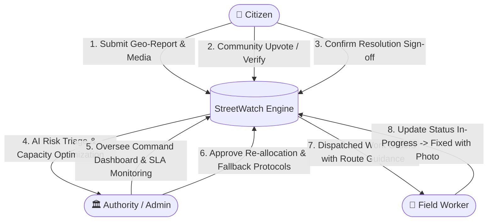

# StreetWatch — Problem Statement & System Requirements

> **Project:** StreetWatch  
> **Track:** World Problem Solver Track  
> **Competition:** Code-ArenaX Hack the Vibe 2026 (Solo Vibe Coding Championship)  
> **Document Stage:** Step 1 — Problem Statement & Requirements Specification  
> **Document Path:** `docs/01-requirements.md`  
> **Status:** Approved Baseline  

---

## 1. Problem Statement

### 1.1 Context & Background
Urban civic infrastructure across growing metropolitan and suburban areas suffers from chronic maintenance delays and operational opacity. Municipalities struggle to manage road defects (potholes, cave-ins), waterlogging, exposed live electric cables, hazardous open manholes, uncollected solid waste, and non-functional street illumination. Citizens regularly experience severe safety hazards, property damage, public health hazards, and reduced quality of life.

While modern citizens carry GPS-enabled, camera-equipped mobile devices, municipal authorities lack a modernized, cohesive digital workflow to ingest, verify, triage, assign, and resolve civic complaints.

### 1.2 Core Pain Points
1. **Proliferation of Duplicate & Spam Reports:**
   - When an open manhole or severe road crater occurs in a dense neighborhood, dozens of citizens submit unstructured, redundant complaints through disparate channels (social media, telephone hotlines, disparate forms).
   - Municipal staff waste hundreds of hours manually filtering duplicates or responding to vague, unverified claims.
2. **Absence of Intelligent, Risk-Based Urgency Triaging:**
   - Traditional systems operate strictly on a naive First-In, First-Out (FIFO) queue.
   - An aesthetic graffiti report or minor littering complaint can take precedence over a life-threatening exposed live wire near a school or a dangerous open manhole on an unlit road.
3. **Opacity, Zero Traceability & Account Disconnect:**
   - After submitting a complaint, citizens are met with a "black box" ticketing portal that gives no status updates, no live geographic visualization, and no estimated time to resolution.
   - Field workers receive ambiguous work orders without accurate coordinates or prioritized dispatch routes.
   - Authorities lack real-time geospatial analytics to monitor contractor SLA compliance or identify systemic district failure clusters.

### 1.3 Comparative Analysis: Traditional Civic Ticketing vs. StreetWatch Platform

| Evaluation Dimension | Legacy Civic Grievance Portals (e.g., 311 / Call Centers) | StreetWatch Autonomous Civic Platform |
| :--- | :--- | :--- |
| **Ingestion Modality** | Slow manual forms, telephone calls, unorganized emails | Fast geo-tagged mobile-responsive web flow with image upload & auto GPS extraction |
| **Duplicate Prevention** | Manual human review; high duplicate backlog | Geospatial proximity radius clustering + AI image hash duplicate detection |
| **Triage & Prioritization** | FIFO (First-In, First-Out); no dynamic risk evaluation | **Explainable AI Multi-Criteria Scoring (A02)**: Combines severity, public safety risk, community consensus, and department capacity |
| **Verification Loop** | Blind trust or slow physical inspection visits by field supervisors | **Decentralized Community Consensus**: Local nearby citizens verify & upvote issues with fraud-resistant location validation |
| **Dispatch & Assignment** | Manual desk dispatcher phone calls and paper work-orders | **Constraint-Aware Auto Dispatching (A02/A07)** matching issue category, worker availability, proximity, and urgency |
| **Lifecycle & Status** | Static binary flags (`Open` / `Closed`) with no intermediate visibility | **Automated 8-Stage Multi-Step Pipeline (A07)** with step-level rollback, timeout escalation, and dual-party audit trails |
| **Resolution Validation** | Authority marks "Resolved" unilaterally without citizen proof | Before/After photo evidence mandatory + Citizen & Community verification sign-off |
| **Public Transparency** | Private, siloed internal database hidden from public view | **Live Interactive Public City Map**: Real-time filtered map with bento metrics and public auditability |

---

## 2. User Personas & Use Cases

### 2.1 Persona Matrix Overview



### 2.2 Persona Specification & Detailed Use Cases

#### Persona A: The Vigilant Citizen (e.g., Tanvir Ahmed — Commuter & Resident)
- **Role & Profile:** Active urban resident navigating city streets daily; seeks safe pedestrian paths and clean public spaces.
- **Permissions:**
  - Create, view, edit (while pending triage), and withdraw personal issue reports.
  - Upvote and verify reports submitted by others located within a defined neighborhood radius (e.g., within 2.5 km).
  - Submit comments and supplementary photos on active public reports.
  - Validate or dispute marked resolutions with photographic counter-evidence.
  - View public map, filter by category/district/urgency, and inspect resolution timelines.
- **Key Use Cases:**
  - **UC-C01 (Report Submission):** Capture image of an open sewer, auto-attach geolocation, select category, add description, and submit within 45 seconds.
  - **UC-C02 (Community Verification):** Receive notification of an issue reported nearby; confirm its physical existence and severity to elevate community trust score.
  - **UC-C03 (Resolution Verification):** Inspect field worker's "After" repair photo; approve resolution or reopen ticket if the hazard persists.

#### Persona B: The Municipal Authority & District Engineer (e.g., Engr. Farhana Yasmin)
- **Role & Profile:** City administrator or departmental director (Roads & Highways, Power & Energy, Water & Sewerage, Waste Management) accountable for budget, SLAs, and public safety.
- **Permissions:**
  - View full district command dashboard with aggregate KPIs and live spatial density heatmaps.
  - Configure rule engine thresholds (e.g., severity weights, escalation deadlines).
  - Inspect AI priority explanations and worker assignment recommendations.
  - Override automated worker dispatches with logged administrative justification.
  - Access system audit trails, worker efficiency metrics, and SLA breach reports.
- **Key Use Cases:**
  - **UC-A01 (Live Command Monitoring):** Filter high-risk critical safety hazards across Ward 4, inspect AI urgency rationales, and verify crew availability.
  - **UC-A02 (Conflict & Constraint Management):** When emergency flood warnings create 50 simultaneous critical reports exceeding crew capacity, activate AI fallback constraint recommendations (triage queue reorganization, inter-departmental resource borrowing).
  - **UC-A03 (SLA & Audit Management):** Review contractor resolution timelines, analyze verified completion photos, and download compliance audits.

#### Persona C: The Departmental Field Worker / Crew Lead (e.g., Rafiqul Islam)
- **Role & Profile:** Mobile technician or municipal maintenance contractor dispatched to execute physical repairs on site.
- **Permissions:**
  - Access mobile-optimized worker task feed showing assigned work orders sorted by urgency and route proximity.
  - Acknowledge assignment, update transit/work state (`Assigned` → `In Progress` → `Resolved`).
  - Upload mandatory post-repair photographic proof with GPS and timestamp validation.
  - Request emergency escalation or additional equipment/supplies if site hazards exceed original assessment.
- **Key Use Cases:**
  - **UC-W01 (Task Ingestion):** Check daily prioritized work orders, read AI triage brief, review citizen photos and exact map pin.
  - **UC-W02 (Execution & Evidence Upload):** Arrive on site, mark ticket `In Progress` to trigger live map status update; complete repair, capture high-res "After" image, add materials note, and submit for resolution sign-off.
  - **UC-W03 (Blocked Task Escalation):** Report structural impediment (e.g., gas pipe interference during road dig); pause task and trigger automated workflow escalation to district engineer.

---

## 3. MVP Feature List & Functional Modules

### 3.1 Module 1: Citizen Engagement & Public Transparency Portal (M01, M05, M07)
- **Instant Geo-Report Creation Wizard:**
  - Multi-step lightweight form with image dropzone (drag-and-drop or camera capture).
  - Client-side EXIF/GPS coordinate extraction with fallback interactive map pin picker.
  - Structured categorical selection: `Pothole / Road Damage`, `Exposed Electric Cables`, `Waterlogging / Drainage Failure`, `Open Manhole`, `Uncollected Garbage / Waste Spill`, `Broken Streetlight / Dark Spot`.
- **Public City Map & Bento Exploration View:**
  - Split-screen layout: Interactive Leaflet/MapLibre map canvas on right + filterable virtualized card list on left.
  - Dynamic filters: Status (`Reported`, `Verified`, `In Progress`, `Resolved`), Category, Urgency (`Low`, `Medium`, `High`, `Critical`), District/Ward.
  - Real-time text search with debounce across title, description, and street name.
  - Bento statistical widgets displaying active open hazards, 24h resolution rate, and high-risk hotspots.
- **Community Verification & Social Consensus:**
  - Anti-fraud upvoting: Citizens can confirm ("I see this too") with location-validated proximity checks and 1-vote-per-user enforcement.
  - Community discussion thread on each issue ticket with moderation flags.

### 3.2 Module 2: Authority Command Dashboard & Administration (M01, M03, M04, M05)
- **Executive Bento Analytics Grid:**
  - Dynamic KPI cards: Total Active Issues, Critical Unassigned Hazards, Average Mean Time to Resolution (MTTR), SLA Breach Count.
  - Category breakdown donut chart and weekly resolution velocity trend charts.
- **Issue Dispatch & Department Allocation Console:**
  - Table and Kanban views of issues across workflow stages.
  - Deep-dive issue inspection modal: citizen evidence, AI triage assessment breakdown, duplicate cluster links, audit log history.
  - Manual override controls allowing managers to reassign, pause, or re-prioritize issues with mandatory audit notes.
- **Worker & Resource Capacity Manager:**
  - Live roster of field teams per department, active assigned workload counts, and availability flags (`Available`, `Busy`, `Off-Duty`).

### 3.3 Module 3: Field Worker Mobile Operations Portal (M01, M07)
- **Task Dispatch Feed:**
  - Responsive, high-contrast, touch-optimized card list showing assigned tickets.
  - Direct turn-by-turn map navigation launcher (Google Maps / OpenStreetMap deep link).
- **Execution & Proof-of-Work Terminal:**
  - Single-tap state progression buttons with confirmation guardrails.
  - Mandatory "After" photo upload with camera preview and description input.
  - Incident blocker reporting modal (e.g., weather delay, utility hazard).

### 3.4 Module 4: Intelligent Decisions & Optimization Engine (**Advanced Challenge A02**)
- **Explainable AI Priority Scoring Engine (XAIPSE):**
  - Evaluates every incoming report through a transparent, mathematical formula:
    $$\text{Priority Score } (0 - 100) = w_s \cdot S + w_r \cdot R + w_c \cdot C + w_u \cdot U$$
    - $S$: Hazard Severity Index ($0 - 40$), derived from category danger profile (e.g., exposed electric wire = 40, small litter = 5).
    - $R$: Spatial Vulnerability & Location Risk ($0 - 25$), factoring proximity to schools, hospitals, arterial highways, and historical accident density.
    - $C$: Community Consensus & Trust Weight ($0 - 20$), calculated as a logarithmic scale of unique, verified citizen upvotes within $2.5\text{ km}$.
    - $U$: Time Aging & SLA Escalation Decay ($0 - 15$), escalating linearly as elapsed time approaches statutory SLA limits.
  - **Explainability Card:** Every ticket displays a clear visual breakdown showing *why* the score was awarded (e.g., "Score 87/100: +40 Critical Electrical Hazard, +20 Near Primary School, +15 Overdue SLA, +12 18 Local Upvotes").
- **Constraint-Based Optimization & Conflict Handling:**
  - Optimization Goal: Minimize global response time while matching specialized crew qualifications and preventing worker overload (max concurrent tasks $N = 3$).
  - **Infeasible / Conflicting Request Protocol:**
    - *Scenario:* High-priority emergencies arrive simultaneously, but all relevant departmental field workers are fully booked ($100\%$ capacity).
    - *Automated Resolution:*
      1. Trigger automated preemption check: Evaluate if existing lower-priority tasks (`Medium`/`Low`) can be safely paused to free up crew.
      2. If all active tasks are also `Critical`, activate inter-departmental secondary responder protocol (e.g., general municipal crew dispatched for safety perimeter containment).
      3. Emit high-priority administrative alert with actionable recommendation logs explaining the conflict and suggested action.

### 3.5 Module 5: Automated Multi-Step Workflow Engine (**Advanced Challenge A07**)
- **Event-Driven 8-Stage Lifecycle State Machine:**
  ```text
  [1. REPORTED] ────────► [2. AI_TRIAGED] ────────► [3. COMMUNITY_VERIFIED]
                                                            │
  [6. IN_PROGRESS] ◄──── [5. DISPATCHED] ◄────── [4. PRIORITY_SCORED]
         │
         ▼
  [7. WORKER_RESOLVED] ──► [8. CITIZEN_VERIFIED / CLOSED]
         │                              ▲
         └── (Disputed / Reopened) ─────┘
  ```
- **Robust Step-Level Tracking & State Persistence:**
  - Every transition writes an immutable event record into `WorkflowStepLog` (Step ID, Timestamp, Actor ID, State Before, State After, Execution Duration, Metadata JSON).
- **Failure Recovery, Rollback & Escalation Logic:**
  - *Automated Retries:* External API calls (geocoding, image analysis, notifications) employ exponential backoff with jitter (max 3 retries).
  - *Worker Non-Response Timeout:* If an assigned worker does not acknowledge within 45 minutes, the workflow unassigns the worker, logs a timeout event, rolls the ticket back to `PRIORITY_SCORED`, and triggers priority re-dispatch.
  - *Mid-Workflow Disruption Recovery:* If an external service or database commit fails during a multi-entity transition, the database transaction performs an atomic rollback (`ACID`), returning the ticket to its verified previous state with an incident alert.

---

## 4. Project Scope (In-Scope vs. Out-of-Scope)

### 4.1 In-Scope (Strict MVP for Hackathon Excellence)
- **End-to-End Civic Lifecycle:** Complete path from Citizen report submission $\to$ AI triage $\to$ Community upvoting $\to$ Rule engine priority calculation $\to$ Admin/Worker assignment $\to$ Proof-of-repair upload $\to$ Citizen sign-off.
- **Relational Data Integrity (PostgreSQL / SQLite via Prisma/Drizzle):** Fully relational schema with foreign key cascades, unique constraints, and ACID transactions.
- **Role-Based Authentication & Authorization:** Secure session/token authentication with 3 distinct roles (`CITIZEN`, `AUTHORITY_ADMIN`, `FIELD_WORKER`) and route guard protection.
- **Public Interactive Map:** Real-time spatial visualization using OpenStreetMap / Leaflet with dynamic markers, clustering, and filter controls.
- **Full Implementation of Challenge A02:** Transparent Explainable AI priority calculation and constraint-handling fallback engine with testable conflict scenarios.
- **Full Implementation of Challenge A07:** Event-driven state machine with comprehensive audit trails, worker timeout fallbacks, and atomic transaction rollbacks.
- **Responsive Modern UI:** Tailwind CSS Bento Grid architecture adhering to the specified `#F8FAFC` clean aesthetic, accessible touch targets, and ARIA semantic attributes.

### 4.2 Out-of-Scope (Deferred Post-Hackathon Enhancements)
- Native mobile applications (iOS/Android native binaries); a high-fidelity mobile-responsive Progressive Web App (PWA) layout covers this requirement.
- Real-time video streaming or live CCTV camera ingestion.
- Direct hardware integration with municipal IoT storm-drain telemetry sensors.
- Real monetary municipal fine payment processing or fiscal budget disbursal systems.

---

## 5. Testable Acceptance Criteria & Verification Matrix

| ID | Category | Requirement Focus | Concrete Acceptance Criteria & Verification Method |
| :--- | :--- | :--- | :--- |
| **AC-M01** | Mandatory | Complete Functional System | Citizen creates report; Authority views and dispatches; Worker accepts and resolves; Citizen confirms. All 3 modules operate harmoniously on shared state. |
| **AC-M02** | Mandatory | Database CRUD & Relations | Complete Create, Read, Update, Delete across Reports, Comments, Users, and Assignments. Deleting a test report cascades cleanly without orphaned records. |
| **AC-M03** | Mandatory | Auth & Access Control | Attempting to access `/admin` or `/worker` routes with a `CITIZEN` token fails with HTTP `403 Forbidden`. Unauthenticated requests redirect to `/login`. |
| **AC-M04** | Mandatory | Complex Business Logic | A report cannot transition directly from `REPORTED` to `RESOLVED` without traversing `DISPATCHED` and `IN_PROGRESS`. State transitions strictly enforce guard conditions. |
| **AC-M05** | Mandatory | Dynamic Data Processing | Multi-criteria search (e.g., Category = `Pothole` AND Urgency = `Critical` AND Status = `In Progress`) filters results within < 100ms; dashboard KPI aggregations update dynamically. |
| **AC-M06** | Mandatory | Error & Edge-Case Handling | Submitting empty fields, coordinates outside city bounding box, or unsupported image formats yields explicit inline validation errors. Double-clicking "Submit" prevents duplicate records via idempotency tokens. |
| **AC-M07** | Mandatory | Responsive UI & Accessibility | Layout renders flawlessly on 375px mobile viewport, 768px tablet, and 1440px desktop. Interactive controls support full keyboard navigation (`Tab`, `Enter`, `Escape`) with aria labels. |
| **AC-M08** | Mandatory | Deployment & Documentation | Project builds clean with zero lint warnings; complete `README.md` provides reproduction steps, environment variable definitions, and system architecture diagrams. |
| **AC-A02.1** | Advanced A02 | Explainable AI Priority | Submitting a report near a school with high severity computes an explainable score; the UI renders the exact mathematical breakdown of weights. |
| **AC-A02.2** | Advanced A02 | **Conflicting Constraints Test** | **Boundary Test:** Simulate 10 simultaneous Critical issues when all departmental field workers have maxed task queues ($3/3$). System flags crew exhaustion, prevents silent drops, triggers preemption recommendations for low-priority tasks, and logs a transparent fallback plan for the authority. |
| **AC-A07.1** | Advanced A07 | Multi-Step Workflow Pipeline | System records each stage transition in `WorkflowStepLog` with monotonic timestamps, actor identities, and state snapshots. |
| **AC-A07.2** | Advanced A07 | **Mid-Workflow Failure & Recovery Test** | **Boundary Test:** Simulate an unexpected worker abandonment / network drop during the `IN_PROGRESS` stage. Once the inactivity timeout threshold is breached, the engine triggers an automatic recovery event: revoking worker lock, logging failure audit reason, reverting state to `PRIORITY_SCORED`, and alerting dispatch. |

---

## 6. UI/UX Design Baseline Specifications

```text
Visual Foundation:
├── Background: #F8FAFC (Clean light slate canvas)
├── Surfaces: #FFFFFF (White rounded bento cards with border #E2E8F0)
├── Typography: Inter / Plus Jakarta Sans (#0F172A primary headers, #64748B secondary text)
├── Accent Colors:
│   ├── Primary Brand: #2563EB (Royal Blue)
│   ├── Critical / Danger: #DC2626 (Crimson Red)
│   ├── In-Progress / Warning: #D97706 (Amber)
│   └── Resolved / Success: #059669 (Emerald Green)
└── Spatial Layout:
    ├── Citizen / Public: Split-screen (Left: Filterable virtualized card feed, Right: Interactive Leaflet Map)
    ├── Authority: Modular Bento Grid (2x2 KPI metrics + dynamic heatmap + dispatch queue)
    └── Field Worker: Compact mobile card stack with high-contrast action triggers
```
