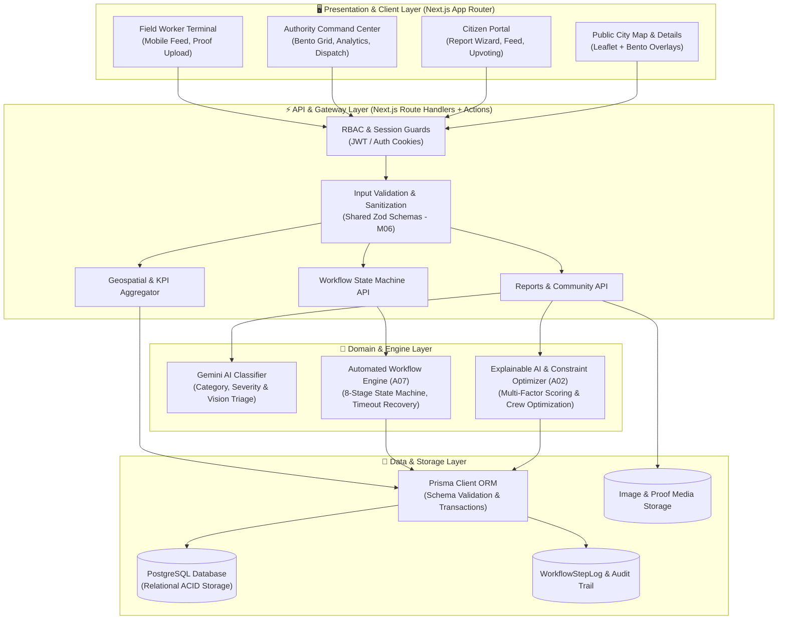
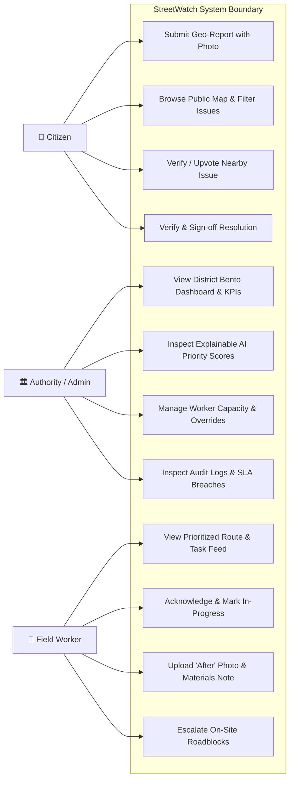
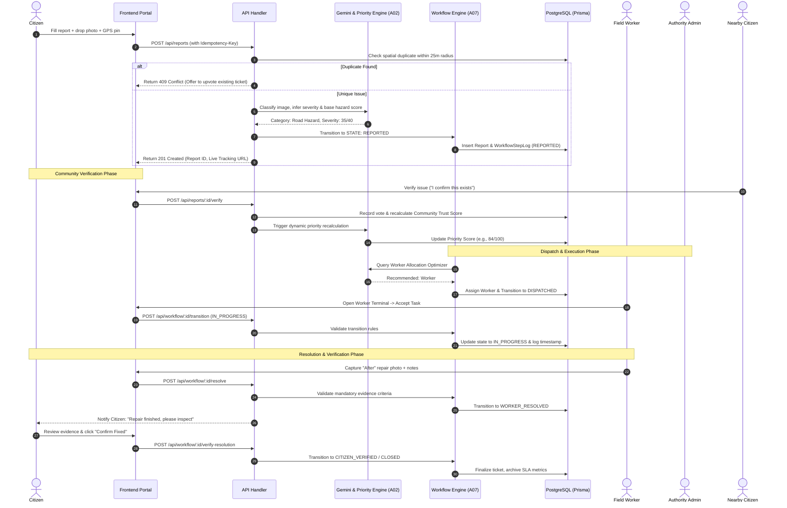
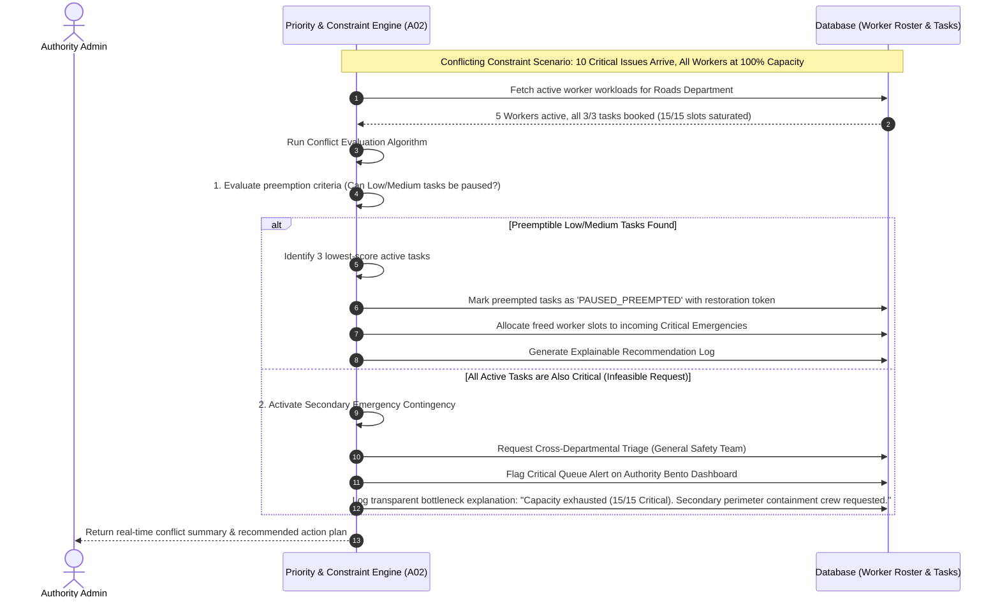
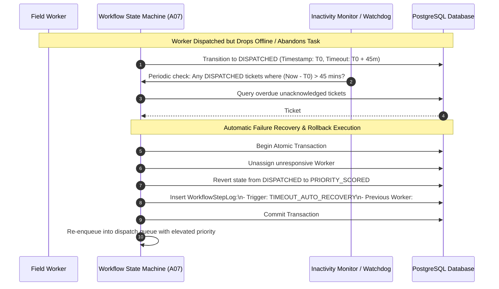

# StreetWatch — System Architecture & Design Specification

> **Project:** StreetWatch  
> **Track:** World Problem Solver Track  
> **Competition:** Code-ArenaX Hack the Vibe 2026  
> **Document Stage:** Step 2A — System Design & Architecture Blueprint  
> **Document Path:** `docs/02-architecture.md`  
> **Status:** Approved Baseline  

---

## 1. High-Level System Architecture

StreetWatch is architected as a modular, layered full-stack application built on **Next.js (App Router)** with **TypeScript**, **PostgreSQL (Prisma ORM)**, and **Tailwind CSS**. It combines real-time geographic visualization, explainable AI decision optimization, and an event-driven state machine for civic problem resolution.



---

## 2. Layered Component Architecture

| Layer | Technologies & Location | Primary Responsibilities |
| :--- | :--- | :--- |
| **Presentation Layer** | Next.js App Router, Tailwind CSS, Lucide Icons (`src/app/`, `src/components/`) | Renders mobile/desktop responsive interfaces following the Minimalist + Bento Grid design language (`#F8FAFC` canvas, `#FFFFFF` cards, `#0F172A` text, `#2563EB` primary). Interactive Leaflet mapping with glassmorphic cards. |
| **Validation & Security Layer** | Zod, Jose/Bcrypt, Middleware (`src/lib/auth/`, `src/lib/validations/`) | Enforces role-based route guards (`CITIZEN`, `AUTHORITY_ADMIN`, `FIELD_WORKER`). Validates coordinate bounds, MIME types, text limits, and idempotency keys to prevent duplicate actions. |
| **Domain Logic Engines** | TypeScript, Gemini API (`src/lib/ai/`, `src/lib/workflow/`) | **A02:** Computes explainable priority metrics, detects spatial duplicates, and resolves worker allocation conflicts under 100% capacity bottlenecks.<br>**A07:** Orchestrates the 8-stage state machine with automatic rollbacks and worker inactivity escalation. |
| **Data Persistence Layer** | Prisma ORM, PostgreSQL (`prisma/`, `src/lib/prisma.ts`) | Executes transactional ACID mutations, maintains relational integrity across reports, assignments, and audit logs. |

---

## 3. UML Use Case Architecture



---

## 4. End-to-End Dataflow & Sequence Diagrams

### 4.1 Sequence 1: Complete 8-Stage Civic Issue Lifecycle (M01, M04)



---

### 4.2 Sequence 2: Explainable AI Priority & Constraint Optimization under Contention (**Challenge A02**)



---

### 4.3 Sequence 3: Event-Driven Workflow Recovery & Rollback (**Challenge A07**)



---

## 5. Folder Structure & Architectural Blueprint

```text
streetwatch/
├── docs/
│   ├── 01-requirements.md        # Step 1: Requirements, Personas, Acceptance Criteria
│   ├── 02-architecture.md        # Step 2A: System Architecture & Mermaid Dataflows
│   ├── 03-database.md            # Step 2B: Database Schema, Relations & Data Dictionaries
│   ├── 04-api-contracts.md       # Step 2B: OpenAPI / REST API Contracts & Payload Schemas
│   └── 05-ui-ux-blueprint.md     # Step 2C: Bento Grid Layouts & Component Tree
├── prisma/
│   └── schema.prisma             # Relational Database Schema & Migrations
├── src/
│   ├── app/
│   │   ├── (auth)/               # Login & Register views (M03)
│   │   ├── (public)/             # Public City Map, Issue Detail, Transparency Feed (M01, M05)
│   │   ├── (citizen)/            # Citizen Dashboard, Report Wizard, My Submissions
│   │   ├── (authority)/          # Command Center, Bento Analytics, Worker Dispatch (M01, A02)
│   │   ├── (worker)/             # Mobile Worker Terminal, Active Tasks, Proof Upload (M01)
│   │   └── api/                  # REST API Route Handlers (auth, reports, verify, workflow, admin)
│   ├── components/
│   │   ├── ui/                   # Button, Card, Badge, Modal, Input, Bento primitives
│   │   ├── map/                  # Leaflet Map Canvas, Pin Clusters, Glassmorphic Filter Overlay
│   │   ├── dashboard/            # Bento Metric Cards, Explainable AI Meter, Step-by-Step Tracker
│   │   └── forms/                # Report Creation Wizard, Photographic Proof Uploader
│   ├── lib/
│   │   ├── ai/                   # Gemini Vision Triage & A02 Explainable Priority Optimizer
│   │   ├── workflow/             # A07 Event-Driven State Machine & Inactivity Recovery
│   │   ├── auth/                 # RBAC Guards, JWT Session Token verification
│   │   └── validations/          # Shared Zod Schemas for payload validation (M06)
│   └── types/                    # Shared TypeScript interfaces, enums, API responses
```
