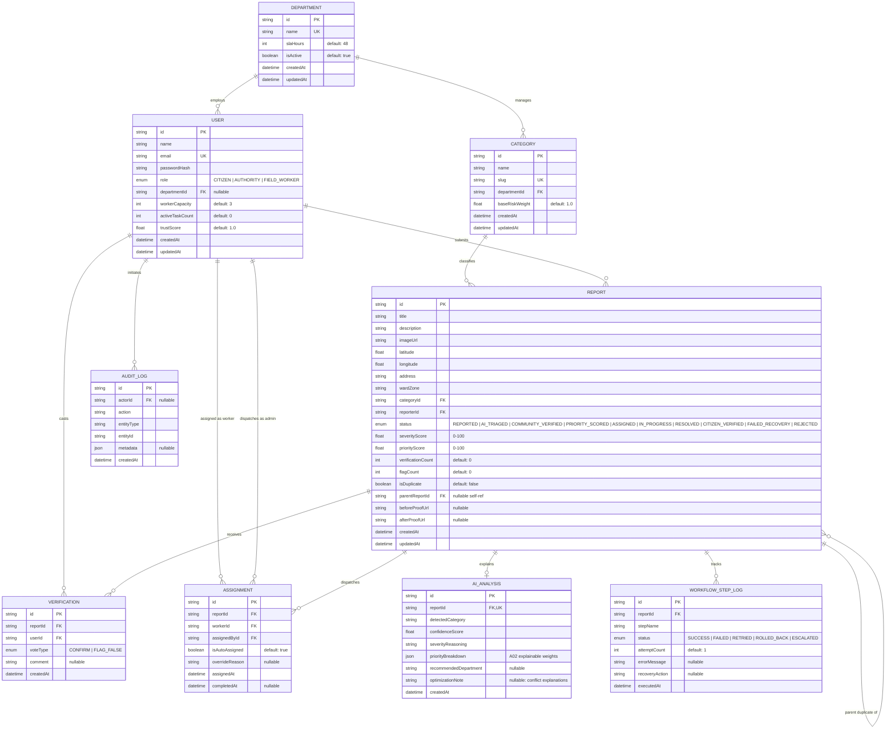

# StreetWatch — Database Design & Entity Relationship Model

> **Project:** StreetWatch  
> **Track:** World Problem Solver Track  
> **Competition:** Code-ArenaX Hack the Vibe 2026  
> **Document Stage:** Step 2B — Database ER Model & Schema Architecture  
> **Document Path:** `docs/03-database.md`  
> **Status:** Approved Baseline  

---

## 1. Entity Relationship (ER) Diagram



---

## 2. Model Specifications & Design Objectives

### 2.1 User & Access Control (M03)
- Stores identity and credentials for all three personas (`CITIZEN`, `AUTHORITY`, `FIELD_WORKER`).
- `workerCapacity` (default: 3) and `activeTaskCount` enable deterministic, real-time worker load tracking for the **A02 Constraint Optimizer**.
- `trustScore` enables weighted community verification calculations so verified citizens have proportional voting influence.

### 2.2 Department & Category Taxonomy
- Maps urban problem categories (e.g., `Roads & Potholes`, `Live Electric Cables`, `Open Manholes`, `Waterlogging`) directly to responsible municipal departments.
- `baseRiskWeight` provides a static baseline danger multiplier used in the A02 mathematical priority formula.

### 2.3 Report (Core Civic Entity — M01, M02, M05)
- Captures geospatial coordinates (`latitude`, `longitude`, `wardZone`) indexed for low-latency spatial clustering and map queries.
- `parentReportId` and `isDuplicate` enable spatial duplicate clustering: when duplicate issues are identified within a 25-meter radius, new submissions are linked to the primary parent ticket rather than polluting the municipal queue.
- Dual proof URLs (`beforeProofUrl` and `afterProofUrl`) enforce visual accountability before a ticket can transition to resolution.

### 2.4 AIAnalysis (Explainable AI — Advanced Challenge A02)
- Stores transparent machine reasoning:
  - `priorityBreakdown`: JSON object storing individual factor contributions:
    ```json
    {
      "severityWeight": 35.0,
      "locationRiskWeight": 20.0,
      "communityConsensusWeight": 14.2,
      "slaDecayWeight": 12.0,
      "capacityPenalty": 0.0,
      "formula": "Score = 35.0 + 20.0 + 14.2 + 12.0 - 0.0 = 81.2"
    }
    ```
  - `optimizationNote`: Records conflict resolution rationales when worker capacity saturation triggers automated preemption or secondary dispatch.

### 2.5 Verification (Fraud & Duplicate Vote Prevention — M06)
- **Hard Database Constraint:** `@@unique([reportId, userId])` guarantees that no citizen can cast multiple confirmation votes or spam flags on a single report.
- Dynamic aggregation updates `verificationCount` and `flagCount` on the parent report in an ACID transaction.

### 2.6 Assignment (Work Order Dispatch & Conflict Logging)
- Records worker dispatch events with timestamps and assignment origins (`isAutoAssigned: true/false`).
- `overrideReason` persists human supervisor justifications or automated fallback reasons when capacity limits require re-allocation.

### 2.7 WorkflowStepLog (Step Tracking & Inactivity Recovery — Advanced Challenge A07)
- Provides granular lifecycle traceability for all transitions.
- Records step attempts, error stack traces, and automatic rollback actions (e.g., worker timeout $\to$ state rolled back to `PRIORITY_SCORED` with unassign action).

### 2.8 AuditLog (System Security & Accountability)
- Immutable event logging of administrative actions, role modifications, manual priority overrides, and state transitions for compliance review.
